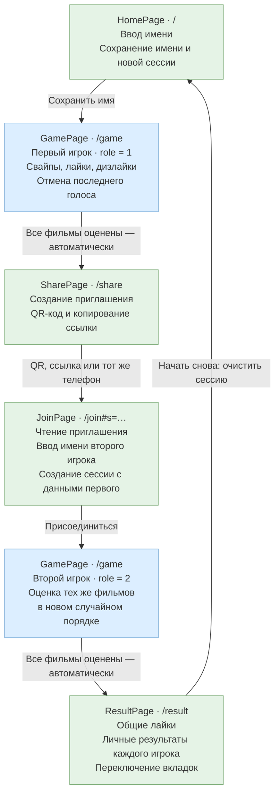
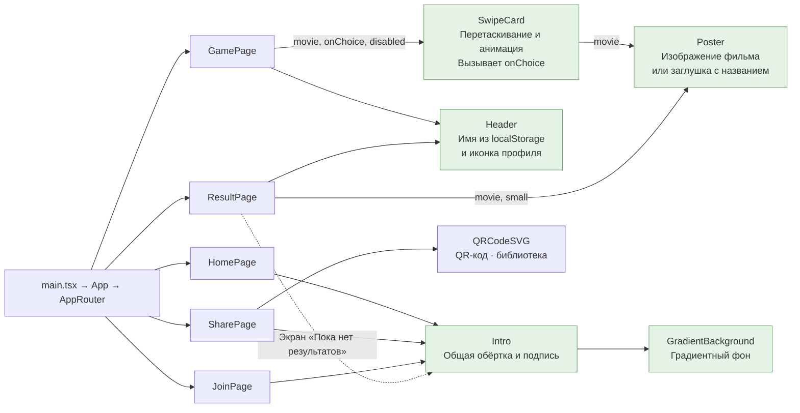
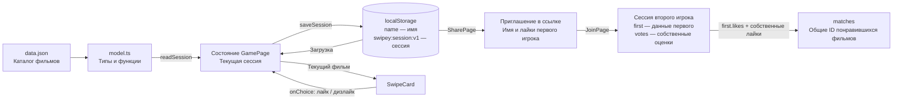

# Swipey — шпаргалка по приложению

Схема соответствует `main`, коммит `81e789a`.
Диаграммы Mermaid отображаются прямо на GitHub.

## Страницы и сценарий игры

Синие блоки — одна и та же `GamePage` для разных игроков.

## Какие компоненты используют страницы

Стрелка означает «рендерит компонент». `Intro` выводит `children` внутри общей обёртки.

## Проверки при открытии страниц

Ромбы — условия. Красные блоки — сообщения на текущей странице; оранжевые — автоматические перенаправления.

```mermaid
flowchart TD
    subgraph gameChecks["GamePage · /game"]
        gSession{"Есть сессия?"}
        gComplete{"Все фильмы оценены?"}
        gRole{"Первый игрок?"}
        gHome["Переход на /"]
        gPlay["Показать текущий фильм"]
        gShare["Переход на /share"]
        gResult["Переход на /result"]
        gSession -->|"Нет"| gHome
        gSession -->|"Да"| gComplete
        gComplete -->|"Нет"| gPlay
        gComplete -->|"Да"| gRole
        gRole -->|"Да · role = 1"| gShare
        gRole -->|"Нет · role = 2"| gResult
    end
    subgraph shareChecks["SharePage · /share"]
        sValid{"Есть сессия первого игрока<br/>и все фильмы оценены?"}
        sHome["Переход на /"]
        sShow["Показать приглашение"]
        sValid -->|"Нет"| sHome
        sValid -->|"Да"| sShow
    end
    subgraph joinChecks["JoinPage · /join"]
        jValid{"Приглашение из hash<br/>удалось прочитать?"}
        jError["«Приглашение не найдено»<br/>Остаёмся на странице"]
        jForm["Показать форму имени"]
        jValid -->|"Нет"| jError
        jValid -->|"Да"| jForm
    end
    subgraph resultChecks["ResultPage · /result"]
        rValid{"Есть сессия, role = 2,<br/>данные first и все голоса?"}
        rError["«Пока нет результатов»<br/>Кнопка «На главную» → /"]
        rShow["Показать результаты"]
        rValid -->|"Нет"| rError
        rValid -->|"Да"| rShow
    end
    classDef redirect fill:#fff0d6,stroke:#d5a04c
    classDef error fill:#ffe5df,stroke:#cf8270
    classDef success fill:#e5f3e6,stroke:#73a66e
    class gHome,gShare,gResult,sHome redirect
    class jError,rError error
    class gPlay,sShow,jForm,rShow success
```

Дополнительные условия внутри страниц:

| Где | Условие → поведение |
|---|---|
| `HomePage` | Проверок при входе нет. Пустое имя тоже позволяет начать игру. |
| `GamePage` | Нет голосов → «Отменить» недоступно. Не все фильмы оценены → «Завершить» недоступно. |
| `JoinPage` | Пустое имя после `trim()` → нельзя присоединиться. Поле ограничено 40 символами. |
| `ResultPage` | Список выбранной вкладки пуст → сообщение вместо постеров. |
| `Poster` | Нет изображения → заглушка с названием, годом и жанром. |

## Как связаны данные

`useState` хранит данные для отображения интерфейса, а `localStorage` сохраняет их между перезагрузками. Первый игрок передаёт свои результаты второму через ссылку — серверной синхронизации нет.

Стили приложения находятся в `src/App.css`, сброс стилей — в `src/index.css`.
